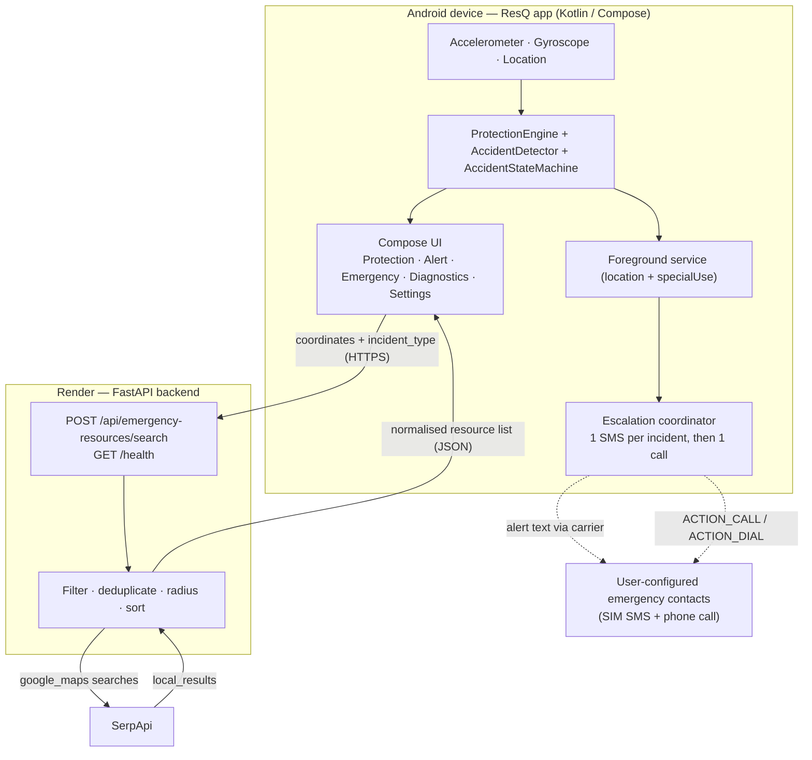

# ResQ — Emergency Response Companion

ResQ is an Android app that tries to shorten the gap between **something going
wrong** and **someone who can help finding out**.

When a person is in a road accident, a crash, or any sudden emergency, the
hardest part is often not the injury itself but *communication*: telling someone
what happened, telling them where it happened, and finding out which hospital,
trauma centre or blood bank is actually near them. A person who is unconscious,
in shock, or alone cannot do any of that.

ResQ watches the phone's own motion sensors while the user is travelling. If the
sensors suggest a possible incident, the app asks the user — audibly and on
screen — whether they are okay. If the user does not answer, ResQ moves into an
emergency flow: it sends one prepared alert text from the user's own SIM to the
emergency contacts the user saved earlier, then rings the user's chosen primary
contact, and shows the nearest hospitals, emergency care and blood banks it can
find. If the user is fine, they tap once and nothing happens.

It is intended for everyday people who travel alone, for riders and drivers, for
people who work late or in unfamiliar areas, and for anyone who has someone they
would want told if they stopped responding.

**ResQ is built on two ideas:**

1. **The phone already has the sensors, the location and the SIM.** ResQ tries to
   use them to escalate on the user's behalf for the few minutes when the user
   cannot.
2. **Honesty over optimism.** ResQ reports only what the platform actually
   confirms. It never claims a message was delivered, a call was answered, or a
   hospital is open when it does not know.

---

## ⚠️ Important project status and disclaimer

**ResQ is a hackathon demonstration prototype, built for the SerpApi India
Hackathon 2026.**

It demonstrates an emergency-response workflow. It is **not** a certified or
validated production-grade safety system. It has not been through a safety
assessment, a clinical evaluation, or a regulatory approval process of any kind.

Everything ResQ does can fail or be delayed:

- sensor-based detection can miss an incident or raise a false alarm;
- the phone may have no network, no SIM credit, or no signal;
- SMS delivery and phone calls depend on the carrier, the SIM, the device
  manufacturer's restrictions and the user's permission grants;
- GPS may be unavailable, inaccurate, wrong or hours old;
- the backend and the third-party search API it depends on can be slow, rate
  limited or completely down;
- the hospital, blood bank and emergency-care listings come from a search engine
  and may be incomplete, out of date, closed, or simply wrong.

**Do not rely on ResQ as your only emergency-response method.** In a real
emergency, call your local emergency number.

ResQ does **not** guarantee rescue. It does **not** replace emergency services.
It does **not** detect every accident. It does **not** automatically call 112 (or
any other emergency number) — that button is always a manual action the user
presses.

---

## Project repositories

ResQ is **two separate projects in two separate repositories**:

| Project | Repository | Role |
|---|---|---|
| Android app | <https://github.com/phenomdeekey271020/ResQ-Android> | Kotlin / Jetpack Compose client — this repository |
| FastAPI backend | <https://github.com/PhenomDeekey27/ResQ_Backend> | Nearby-emergency-resource search service and the SerpApi integration |

The two are independent codebases with their own build, test and deployment
setups; a change to one is not a change to the other, and they are versioned
separately. This README describes the Android app.

The backend is also **deployed as a running production service** at
<https://resq-backend-s55p.onrender.com/> — that is the live service URL the app
talks to by default, and it is *not* the backend source repository (the source is
the `ResQ_Backend` repository above).

---

## The problem ResQ addresses

Three things are genuinely hard in the first minutes after an incident:

1. **Communicating that something happened.** An unresponsive person cannot
   tell anyone. Minutes pass before somebody notices.
2. **Communicating *where*.** Even a conscious person often cannot describe
   their position precisely, especially on an unfamiliar road, at night, or in a
   place with no landmarks.
3. **Finding help that is actually near.** "Go to a hospital" is useless without
   knowing which one is closest, or whether a blood bank is within range.

ResQ's intended workflow is: **notice → confirm → escalate → locate help.**

- *Notice*: the phone's accelerometer and gyroscope feed a prototype detector.
- *Confirm*: the user is asked, out loud and on screen, "are you okay?".
- *Escalate*: if there is no answer, one alert text goes to the user's saved
  contacts, and the primary contact is rung.
- *Locate help*: the nearest emergency resources are listed, nearest first.

Every step is a *best effort*. Each one can fail independently, and ResQ is
designed to keep working — with reduced capability and honest wording — when it
does.

---

## How ResQ works

The sequence below describes the **intended application behaviour** as it is
implemented in the current source. It is not a guarantee of what will happen in
every environment.

1. **Protection and sensor monitoring.**
   The user taps **Resume Protection**. The app starts a foreground service that
   keeps accelerometer, gyroscope and location callbacks arriving even with the
   screen off, and posts an ongoing notification so the monitoring is always
   visible. Nothing starts automatically: there is no boot receiver and the
   service is `START_NOT_STICKY`, so ResQ never silently re-arms itself.

2. **Incident detection, or the manual emergency flow.**
   Samples flow through one shared pipeline
   (`SensorGateway → ProtectionEngine → AccidentDetector → AccidentStateMachine`).
   The detector is a transparent, hand-tuned weighted sum over a short sliding
   window — not a trained model. It only reports `POSSIBLE` or `HIGH_CONFIDENCE`
   after several independent signals agree (at least three abnormal samples in
   the window, and rotation evidence, since a straight-line deceleration is
   indistinguishable from a hard brake). The user can skip detection entirely and
   press **"I need help now"** from the home screen.

3. **Countdown, cancellation and confirmation.**
   A possible incident opens an audible and visible alert with a countdown
   (10 s at `POSSIBLE`, 5 s at `HIGH_CONFIDENCE` by default). The user can confirm
   they are fine at any point, which cancels the alert and starts a short cooldown
   so the tail of one event cannot immediately raise a second. If the countdown
   runs out, the app enters a second, unconfirmed-safety window (10 s). Only when
   *that* window also closes with no answer does the flow escalate — the
   countdown is driven by the UI when it is visible, and by the foreground service
   when the screen is off, with exactly one ticker alive at a time.

4. **Emergency escalation to a consenting, user-configured contact.**
   ResQ is now in its emergency state. Escalation is dispatched by a
   process-wide coordinator created by the **foreground service**, not by the
   Activity, so it still runs when the Activity has been destroyed and the screen
   is off. It contacts **only** the contacts the user explicitly saved, and only
   after the user has switched the relevant consent on. Contacts are configured
   with a name and a number, exactly one of them is the primary, and the primary
   selection is re-normalised on every load.

5. **An SMS with useful incident information and location.**
   If SMS escalation is enabled (a separate, default-off consent) and `SEND_SMS`
   is granted and a SIM is present, ResQ sends **one message per incident** to
   each eligible saved contact — at most one per incident, never to the emergency
   number. The message states what was detected, when it was detected, what the
   recipient should do, and a location line **only when there is a plausible,
   real position**:
   - a fresh fix is labelled `Location (current)`;
   - a cached/aged fix is labelled `Last known location, <age> — may be out of
     date, not the current position`;
   - with no usable position there is **no location line at all** — the alert is
     still sent. A missing coordinate never delays an emergency message.

6. **Automatic calling to the configured primary contact.**
   Once — and only once — the carrier has accepted at least one of those
   messages, ResQ attempts **one** call to the saved primary contact for that
   incident. If `CALL_PHONE` is granted and call consent has been given, the app
   asks the platform to place the call directly (`ACTION_CALL`); otherwise it
   opens the dialer pre-filled (`ACTION_DIAL`) for the user to confirm. The
   strongest claim ResQ ever makes is *"ResQ asked your phone to place a call"* —
   it can never know whether the call rang, connected or was answered.

   **Consequence worth stating plainly:** the automatic call is gated on the
   alert text having reached the carrier, and the SMS path in turn requires SMS
   consent. So if SMS consent is off, no `SEND_SMS` grant exists, there is no
   SIM, or no eligible contact is configured, **no automatic call is attempted
   either**. The manual actions on the emergency screen always remain available.

7. **Nearby emergency-resource discovery through the backend and SerpApi.**
   While the emergency screen is open, ResQ asks its own FastAPI backend for
   nearby hospitals, emergency care and blood banks. The backend performs the
   SerpApi searches, normalises the results, removes duplicates, filters by
   distance and sorts them nearest first; the app displays them and re-sorts
   locally as a second guarantee. Each resource card offers **Call** (only when
   the provider returned a phone number) and **Directions** (only when the
   resource itself has coordinates).

8. **Handling of unavailable location, stale location, missing permissions and
   network errors.**
   - No fresh, accurate position → the app does **not** search; it shows an
     explicit "no usable location" state with a **Refresh location** action, and
     explains the actual reason (Location switched off, permission missing,
     acquisition timed out).
   - A cached position that is old, vague or malformed is shown as history and is
     never used as a search centre.
   - Permission refusals are recorded as states, not errors, and ResQ keeps a
     manual fallback for every action.
   - Network, server and unreadable-response failures produce a retryable error
     screen; the search is never retried automatically behind the user's back.

**ResQ never automatically dials 112.** The emergency number is a manual button,
always opened through the dialer so a human confirms it, and it is explicitly
excluded from every automatic SMS and call path.

---

## Features

Verified in the current source code:

| Feature | Status |
|---|---|
| Android app in Kotlin with Jetpack Compose UI | Implemented |
| Protection screen with start/stop of continuous protection | Implemented |
| Accelerometer + gyroscope monitoring via a foreground service | Implemented |
| Prototype incident detection with explainable reasons (not a trained model) | Implemented |
| Alert with countdown, "I'm okay" confirmation, and unconfirmed-safety window | Implemented |
| Manual "I need help now" emergency entry | Implemented |
| Consent-based emergency-contact configuration (name, number, primary) | Implemented |
| Native SMS escalation from the user's own SIM, one message per incident | Implemented |
| Native call escalation to the primary contact (direct call, dialer fallback) | Implemented |
| Location-aware alerts, including fresh vs. last-known vs. no-location wording | Implemented |
| Pre-incident "last known position" cache with expiry and plausibility rules | Implemented |
| Manual emergency-number (112) and contact call actions | Implemented |
| Nearby emergency-resource search through the backend | Implemented |
| Server-side filtering, deduplication, radius limiting and sorting | Implemented |
| Developer / Test Mode with simulations and live diagnostics | Implemented |
| Light and dark appearance modes | Implemented |
| Automated unit tests for the Android app and the backend | Implemented |
| Voice/call escalation through a cloud telephony provider | **Not implemented — interface only, permanently disabled** |

The last row matters: the backend contains a fully specified but deliberately
disabled interface for a future cloud-voice provider, and the prototype does no
cloud calling at all today.

---

## Technology stack and architecture

### Android application (frontend)

| Component | Detail |
|---|---|
| Language | Kotlin 2.2.10 |
| UI | Jetpack Compose (BOM `2026.02.01`) with Material 3 |
| Build | Gradle 9.6.0, Android Gradle Plugin 9.4.1, Kotlin Compose & Serialization plugins |
| SDK levels | `compileSdk 37`, `targetSdk 37`, `minSdk 24` |
| App ID / version | `com.resq.app`, versionCode 1, versionName 1.0 |
| Java level | Source/target compatibility Java 11 (built with JDK 25) |
| Networking | OkHttp 4.12.0 |
| JSON | kotlinx.serialization 1.9.0 |
| Platform APIs | Android sensor framework, `LocationManager`, foreground services, `SmsManager`, `TelecomManager` intents, `NotificationManager`, `TextToSpeech`, SharedPreferences |
| Test libraries | JUnit 4.13.2, OkHttp MockWebServer; AndroidX Compose UI Test, Espresso and AndroidX JUnit for instrumented tests |

State and navigation are held in a single `ResQViewModel` that renders a typed UI
state object; the shared detection pipeline lives behind a process-wide
`ProtectionEngine` so the UI and the foreground service can never disagree about
the current incident. Contacts, consent flags and the last-known-position cache
are stored in private `SharedPreferences` files — no database and no analytics
library was added.

### Backend

| Component | Detail |
|---|---|
| Language | Python 3.11+ (developed on 3.13) |
| Framework | FastAPI 0.111.0 on Uvicorn 0.30.1 |
| Validation | Pydantic v2 with `pydantic-settings` |
| HTTP client | httpx 0.27.0 |
| Tests | pytest 8.2.2 with `pytest-asyncio` and `pytest-mock` |
| Deployment | Render (`Procfile` starts Uvicorn on the platform-provided `PORT`) |
| Persistence | **None.** The service is stateless: no database, no cache, no stored user data |

### External services

| Service | Use |
|---|---|
| **SerpApi** (`google_maps` engine) | The only external data source; see the dedicated section below |

### Development and testing tools

Android Studio (or the Gradle CLI), the Android SDK and platform tools, Python
with a virtual environment, and pytest. The backend is deployed on Render, which
also supplies its HTTPS endpoint.

### Architecture diagram

Solid arrows are real network calls. Dashed arrows are user-mediated
communication that ResQ initiates but does not control.



The SerpApi key exists **only** in the backend's environment. The Android
application has no credential of any kind.

---

## How ResQ uses SerpApi

ResQ needs to answer one question during an emergency: *"what help is physically
near this position right now?"* Phone contacts can be told what happened, but
they still need to know where to go. SerpApi gives ResQ access to **Google Maps
place data** for that radius, without the app needing a Maps SDK key or a Places
billing account of its own.

**Verified request flow:**

```
Android app  →  ResQ FastAPI backend  →  SerpApi (google_maps)  →  backend processing  →  Android app
```

**Search engine and parameters.** For each request the backend calls
`https://serpapi.com/search.json` with `engine=google_maps`, `type=search`, the
query text, the API key, and a location parameter of
`ll=@{latitude},{longitude},14z` built from the incident position.

**Three queries per search.** The backend issues three upstream searches —
`hospital`, `emergency room` and `blood bank` — and tags each normalised result
with `type` (`hospital`, `emergency_care`, `blood_bank`). That is the entire
SerpApi usage in the project.

**Processing on the backend.** Raw `local_results` are normalised into
`{name, address, phone, coordinates, rating}`. The backend then:

1. **deduplicates** — two entries are merged only when the name matches
   case-insensitively *and* the coordinates are within ~100 m; identical names in
   different places are deliberately kept separate;
2. **computes distance** with the Haversine formula (straight-line distance in
   kilometres);
3. **filters by radius** — results outside the configured radius (default 50 km)
   are excluded, as are results without usable coordinates, since no distance can
   be established for them;
4. **sorts nearest first**; the app re-sorts on receipt so the ordering guarantee
   holds regardless of what arrives.

**When things go wrong.** No results at all returns a `no_results` status with an
empty list — a search that ran and found nothing is treated as a valid answer,
not an error. A SerpApi rate limit (HTTP 429) becomes a `503`, an upstream
timeout becomes a `504`, and other upstream failures become a `502`. The app maps
these onto a retryable failure screen with a **Retry search** button; it never
retries on its own, and it never invents or caches a result.

**Why this is a meaningful part of ResQ, not a demonstration request.** The
emergency screen is useless if it can only say "call for help". SerpApi is what
turns a coordinate into an actionable list — the nearest trauma centre, the
nearest blood bank — which is the difference between telling someone to get help
and telling them *where* help is. The integration is on the critical path of the
app's headline feature, and the backend exists largely to keep the API key on the
server side of that boundary.

**The SerpApi key is never in the Android app.** It lives only in the backend's
environment (`.env` locally, platform environment variables on Render). The app
sends three fields — latitude, longitude and the incident type — and receives
resources. No key, and no sample request containing a key, appears in this
README, in the source, in tests, or in the Android configuration. The backend
also logs only the exception *type* for request errors, specifically so a request
URL carrying the key can never reach a log stream.

---

## Project structure

The Android application lives at the repository root; the backend is a
**separate repository** (see Setup below).

```
ResQ-Android/
├── app/
│   ├── build.gradle.kts              # App module: SDK levels, backend URL wiring, deps
│   └── src/
│       ├── main/
│       │   ├── AndroidManifest.xml   # Permissions, activity, foreground service, features
│       │   ├── java/com/resq/app/
│       │   │   ├── MainActivity.kt           # Entry point; builds the ViewModel and its deps
│       │   │   ├── model/                    # UI/domain state models and detection config
│       │   │   ├── data/
│       │   │   │   ├── remote/               # Backend HTTP client and resource repository
│       │   │   │   └── sensors/              # Sensor gateway and location-fix cache
│       │   │   ├── detection/                # Prototype detector, state machine, simulations
│       │   │   ├── protection/               # Shared detection pipeline and engine holder
│       │   │   ├── escalation/               # Escalation coordinator and durable ledger
│       │   │   ├── sms/                      # SMS policy, message builder, platform sender
│       │   │   ├── contacts/                 # Emergency-contact store, policy, call launcher
│       │   │   ├── service/                  # Foreground service and notification copy
│       │   │   ├── alert/                    # Audible alert (tone + speech)
│       │   │   ├── settings/                 # Appearance and protection preferences
│       │   │   ├── ui/                       # Compose app, screens, components, theme
│       │   │   └── viewmodel/                # ResQViewModel — the single UI state holder
│       │   └── res/                          # Icons, fonts, themes, backup rules
│       ├── test/                             # JVM unit tests (no device required)
│       └── androidTest/                      # Instrumented smoke test (device required)
├── gradle/                           # Version catalog and Gradle wrapper
├── build.gradle.kts                  # Root build file
├── settings.gradle.kts               # Module list and repositories
├── gradle.properties                 # Backend URL default and JVM settings
├── DESIGN.md                         # Visual design specification
└── PHYSICAL_DEVICE_TEST_PLAN.md      # Manual device test plan and execution log
```

Backend repository (`ResQ_Backend`):

```
ResQ_Backend/
├── app/
│   ├── main.py               # FastAPI app, CORS, health and root routes
│   ├── config.py             # Settings read from the environment
│   ├── api/routes.py         # Search endpoint: validation, dedupe, filter, sort
│   ├── models/               # Request and response schemas
│   └── services/
│       ├── serpapi.py        # SerpApi client, normalisation, distance maths
│       └── voice.py          # Disabled future cloud-voice interface (no route)
├── tests/                    # pytest suite
├── requirements.txt
├── Procfile                  # Render start command
└── .env.example              # Placeholder environment template
```

---

## Prerequisites

| For | Requirement |
|---|---|
| Android build | Android Studio (recommended) **or** a JDK. The wrapper pins Gradle 9.6.0 and a JVM toolchain of **Java 25**; Android Studio's bundled JDK satisfies this. Android SDK Platform **API 37** and matching build tools must be installed. |
| Android testing | A physical Android device or emulator running **Android 7.0 (API 24) or newer**. SMS and call escalation need a real device with a SIM. |
| Backend | **Python 3.11 or newer** (developed on 3.13) and `pip`. |
| SerpApi | A free or paid **[SerpApi](https://serpapi.com/) API key**, used by the backend only. |
| Optional | `curl` for testing the backend by hand. |

---

## Setup and run instructions

### 1. Clone the Android repository

```bash
git clone https://github.com/phenomdeekey271020/ResQ-Android.git
cd ResQ-Android
```

### 2. Open or build the Android app

**With Android Studio:** open the cloned folder as an existing Android Studio
project and let it sync. `local.properties` (SDK location) is generated
automatically and is intentionally not tracked.

**With the Gradle CLI:**

```bash
# Unit tests (no device required)
./gradlew :app:testDebugUnitTest

# Lint
./gradlew :app:lintDebug

# Debug build → app/build/outputs/apk/debug/app-debug.apk
./gradlew :app:assembleDebug

# Compile the instrumented test source set
./gradlew :app:compileDebugAndroidTestKotlin
```

On Windows use `gradlew.bat` (or `./gradlew` from Git Bash).

### 3. Run the backend locally

Clone the backend repository separately:

```bash
git clone https://github.com/PhenomDeekey27/ResQ_Backend.git
cd ResQ_Backend

python -m venv venv
source venv/bin/activate          # Windows: venv\Scripts\activate
pip install -r requirements.txt
```

### 4. Configure backend environment variables

Copy the provided template and fill in your own value:

```bash
cp .env.example .env              # Windows: copy .env.example .env
```

```
SERPAPI_API_KEY=your_serpapi_key_here
SERPAPI_TIMEOUT=10
LOG_LEVEL=INFO
```

**Never commit `.env`.** It is already listed in the backend's `.gitignore`, and
`.env.example` exists precisely so no real key ever needs to be committed. On
Render, set the same variables in the service's environment settings.

### 5. Get a SerpApi key (backend only)

Create an account at [serpapi.com](https://serpapi.com/) and copy the key into
`SERPAPI_API_KEY`. The key belongs to the backend and to nothing else — do not
add it to the Android project, `gradle.properties`, or any file in this
repository.

### 6. Run the backend

```bash
uvicorn app.main:app --reload --host 0.0.0.0 --port 8000
```

Interactive API documentation is then at `http://localhost:8000/docs`.

### 7. Point the Android app at a backend

The backend address is compiled into the app as `BuildConfig.BACKEND_BASE_URL`.
Resolution order, first match wins:

1. `-Presq_backend_url=…` or the `ORG_GRADLE_PROJECT_resq_backend_url`
   environment variable;
2. the `RESQ_BACKEND_URL` environment variable;
3. the `resq.backend.url` property in `gradle.properties`;
4. the built-in production default,
   `https://resq-backend-s55p.onrender.com`.

The committed default in `gradle.properties` is the deployed Render backend, so
a plain build already talks to production. To use a backend running on your
development machine:

```bash
# Android emulator: 10.0.2.2 is the host machine
./gradlew :app:assembleDebug -Presq.backend.url=http://10.0.2.2:8000

# A physical phone on the same network: use the host's LAN address
./gradlew :app:assembleDebug -Presq.backend.url=http://192.168.1.20:8000
```

The chosen URL is printed in the Gradle output during the build, and the app logs
it under the `ResQBackend` tag at startup so you can confirm what an installed
APK is actually using.

> **Note on HTTP backends:** the app has no cleartext-traffic allowance, and
> intentionally so — production is HTTPS with full TLS validation. A local
> `http://` backend additionally requires a debug-only cleartext configuration
> that is **not** committed. Using the deployed HTTPS backend or a TLS-terminated
> local endpoint avoids the issue entirely.

### 8. Install on a device

Enable Developer Options and USB debugging on the phone, connect it, then:

```bash
./gradlew :app:installDebug
```

Or install the built APK directly:

```bash
adb install -r app/build/outputs/apk/debug/app-debug.apk
```

On Windows, from **PowerShell**, the same command is:

```powershell
adb install -r .\app\build\outputs\apk\debug\app-debug.apk
```

`-r` reinstalls over an existing copy and updates it in place; it only works when
the new APK is signed by the same certificate as the installed one (see the
prebuilt-release section below).

### Installing a prebuilt release instead of building

Tagged **releases** publish a signed, minified release APK as a downloadable
asset, so the app can be installed without a development environment.

All releases live at:

**<https://github.com/phenomdeekey271020/ResQ-Android/releases>**

The workflow is **download → verify → install**:

1. **Download** the APK asset from the Releases page (for example
   `ResQ-v1.0.1-release.apk`). The release notes state the exact filename,
   version and SHA-256 checksum for that asset — the filename in the notes must
   match the file you downloaded.
2. **Verify** the checksum *before* installing anything:

   ```bash
   sha256sum ResQ-v1.0.1-release.apk                        # Linux / macOS
   ```

   ```powershell
   Get-FileHash .\ResQ-v1.0.1-release.apk -Algorithm SHA256  # Windows PowerShell
   ```

   Compare it with the checksum in the release notes. **If they differ, do not
   install the file** — treat it as corrupted or tampered with.
3. **Install** it:

   ```bash
   adb install -r ResQ-v1.0.1-release.apk
   ```

   ```powershell
   adb install -r "$env:USERPROFILE\Downloads\ResQ-v1.0.1-release.apk"
   ```

   The PowerShell example assumes the file was saved to your `Downloads` folder
   and that its name matches the downloaded asset; adjust the path if you saved
   it elsewhere.

**About `-r` and signing certificates.** `-r` means "replace the installed copy
in place", and Android only permits that when the new APK is signed by the
**same** certificate as the one already installed. A debug build and a release
build are signed by **different** certificates, so a release APK cannot be
installed over a debug install (or vice versa) with `-r` — uninstall the other
build first. The debug certificate and this project's release certificate are
**not** interchangeable.

Sideloading a release APK that Android has not seen before normally raises a
**Play Protect** confirmation for an unrecognised developer. That prompt reflects
the signer's reputation, not the APK's contents: it clears as installs of the
same certificate accumulate. Treat it as information to review — only continue if
you trust the source of the file and have verified the checksum, rather than
dismissing security warnings as a matter of course.

---

## Demo and testing

### Exploring the app safely

ResQ ships with a **Developer / Test Mode** screen, reachable from the home
screen or from **Settings → Developer**. It shows live hardware readings,
detection state and prototype confidence, and provides simulation controls:
simulate impact, simulate fall, simulate no response, simulate user OK, simulate
hard braking, and reset.

**Simulated incidents never send real SMS messages and never place real calls.**
An incident created from Test Mode is permanently marked as simulated, and the
escalation coordinator checks that mark before doing anything — so a simulated
emergency walks the whole flow on screen while touching neither the radio nor the
dialer. This is covered by dedicated regression tests.

For a demo, use Test Mode: it lets you show the entire alert → confirmation →
emergency → resource-discovery flow without messaging or ringing anyone. If you
do want to test real escalation, use a **consenting** contact on a second phone —
never the emergency number.

### Automated tests

**Android unit tests** (JVM, no device). From the project root:

```bash
./gradlew :app:testDebugUnitTest
```

Coverage includes the accident detector and state machine, detection maths, the
escalation coordinator, the escalation ledger, the SMS message builder and
recipient policy, contact policy, location freshness and cache persistence,
location-recovery resilience, view-model workflows, backend configuration, and
regression tests for the calling and Test Mode safety guarantees.

**Android lint:**

```bash
./gradlew :app:lintDebug
```

**Instrumented test** (requires a connected device or emulator):

```bash
./gradlew :app:connectedDebugAndroidTest
```

**Backend tests** — from the backend repository, with the virtual environment
active:

```bash
pytest
```

These cover request validation, response schema, distance calculation and
sorting, radius filtering, deduplication, upstream error mapping (timeout, rate
limit, server error), malformed upstream responses, the SerpApi request
parameters, the health and root endpoints, and regression tests that assert the
API key is never logged and that wildcard CORS never advertises credentials.

### What has been verified, and how

Automated results are reproducible with the commands above. Physical-device
results are **not** automated and depend on the specific phone; they are recorded
in `PHYSICAL_DEVICE_TEST_PLAN.md`.

| Verification | Type | Notes |
|---|---|---|
| Android unit tests (496 tests) | Automated, reproducible | 0 failures, 0 errors, 0 skipped |
| Android debug build | Automated, reproducible | Succeeds |
| Android lint | Automated, reproducible | 0 errors; 35 warnings (dependency-version notices, unused resources, KTX suggestions) |
| Instrumented smoke test compiles | Automated | Execution requires a connected device |
| Backend pytest suite (79 tests) | Automated, reproducible | 0 failures |
| Backend `/health` on Render | Manual check | Returns `{"status":"healthy"}` |
| Backend resource search on Render | Manual check | Returns live SerpApi-backed results |
| Release build with R8 (minified, signed) | Automated, reproducible | Succeeds; `minifyReleaseWithR8` and `lintVitalRelease` both pass |
| Release lint (`:app:lintRelease`) | Automated, reproducible | 0 errors; 35 warnings |
| Release APK signing | Automated | `apksigner` verifies the APK against the release certificate (v2 + v3 schemes) |
| R8 release-dex integrity scan | Automated | 0 classes extend a package-private superclass across packages |
| Release APK launch + navigation | **Manual only (physical device)** | Vivo V2561i, Android 16: reached Home, and Home → Settings → Emergency settings → Back → Home, without a crash |
| Full escalation against a real SIM | **Manual only** | Requires a consenting contact and a physical device; not covered by automation |
| Sensor detection on real hardware | **Manual only** | Behaviour varies by device and how the phone is carried |

No coverage percentage, benchmark or screenshot in this repository should be
treated as a guarantee. Anything described as "manual only" above has **not** been
reproduced by the automated suite.

The release build enables R8 code and resource optimization over the whole app
(the AGP 9.3+ `optimization { enable = true }` DSL) with each dependency's own
keep rules applied. It deliberately does **not** use the experimental
`packageScope` option: scoping optimization to selected packages produced a
release dex in which a package-private Kotlin standard-library facade was
extended from a class repackaged into a different package, which crashed the
first time that code was reached. The corrected build is scanned for that class
of defect and comes back clean.

---

## Privacy and permissions

ResQ is designed to keep the user's data on the user's device wherever possible.

### Permissions declared, and why

| Permission | Why it is needed |
|---|---|
| `ACCESS_FINE_LOCATION`, `ACCESS_COARSE_LOCATION` | To put a real position in an alert and to search for help near it. Foreground (while-in-use) access only. |
| `FOREGROUND_SERVICE` | To keep monitoring running while the screen is off or the app is backgrounded. |
| `FOREGROUND_SERVICE_LOCATION` | Required (API 34+) for a service that reads location. Only added at runtime once location permission has actually been granted. |
| `FOREGROUND_SERVICE_SPECIAL_USE` | Declares the continuous accelerometer/gyroscope monitoring, with a written subtype explanation, because it does not fit a predefined type. |
| `POST_NOTIFICATIONS` | For the ongoing "protection is active" notification and the high-importance incident alert. |
| `SEND_SMS` | To send one alert text per incident from the user's own SIM. Default off, separate consent, never in Test Mode, never to the emergency number. |
| `CALL_PHONE` | To ring the user's primary contact when nobody answers, instead of only opening a dialer. Default off, separate consent, at most one attempt per incident, never in Test Mode, never for the emergency number. Without it ResQ falls back to the dialer. |
| `INTERNET` | To reach the ResQ backend for nearby-resource discovery. |

**Deliberately not requested:** `ACCESS_BACKGROUND_LOCATION`, `READ_SMS`,
`RECEIVE_SMS`, `READ_CONTACTS`, `READ_PHONE_STATE`, `RECORD_AUDIO`, camera,
`RECEIVE_BOOT_COMPLETED`, and any accessibility-service capability. ResQ never
arms itself at boot, never reads the user's contact book, never reads incoming
messages, and never uses overlays or accessibility to bypass a platform
restriction.

Accelerometer, gyroscope and GPS hardware are declared as **not required**, so
ResQ is still installable on devices that lack them; the corresponding features
degrade and say so.

### Data: what is collected, stored and transmitted

| Data | Where it lives | Where it goes |
|---|---|---|
| Emergency contacts (name + number) and consent flags | Private app `SharedPreferences`, never exported | Contact details go only to the user's own SMS and dialer. They are **never** sent to the backend. |
| Last known position | Private app `SharedPreferences`, exactly **one** fix, not a history | Included in the alert text when a position exists; the coordinates alone may be sent to the ResQ backend as part of a nearby-resource search. |
| Current position | In memory | Sent to the ResQ backend **only** during an emergency, and only to search for nearby resources. |
| Incident type | In memory | Sent with the position (`possible_accident` in the current flow). |

The backend is **stateless**: it stores no contacts, no coordinates and no
incident records. It forwards the position to SerpApi to perform the search and
returns the results. No analytics, crash-reporting or advertising SDK is present
in the app, and no phone number, coordinate or message body is written to Logcat
at any log level.

### Consent and the location cache

Automatic escalation requires the user's explicit, persisted consent, and the
consent for phone calls and for SMS are **separate** flags — agreeing to be
called is not the same as agreeing to spend mobile credit on texts. Both are off
by default, both are asked for from a visible settings screen (never during an
incident), and both can be revoked.

The location cache holds a single most-recent fix and is re-judged against the
clock every time it is read. A cached fix can never be reported as the current
position: it is either labelled as *last known* history or discarded. Entries
older than 30 minutes, entries vaguer than ~500 m, and the `(0, 0)` "no
position" placeholder are all rejected, and the cache is never used as a search
centre.

**This document is not a privacy policy, and ResQ has not undergone a formal
privacy audit or legal compliance review.** Before any distribution to the
public, a privacy policy and the applicable store disclosures would need to be
written.

---

## Limitations and safety

- **ResQ is a hackathon prototype, not a certified emergency service.** It has no
  safety certification and no regulatory approval.
- **Detection is heuristic.** It may produce false positives (a pothole, a
  dropped phone) or miss real incidents entirely. It is not a crash detector and
  its confidence value is not a probability.
- **SMS and calls depend on things ResQ does not control**: permission grants,
  carrier service, SIM presence and credit, the device manufacturer's background
  restrictions, and Android's limits on background activity starts. A call may
  not be placeable while the screen is locked.
- **ResQ cannot know what happened after it acted.** It never claims a message
  was delivered, a call connected, or a person answered.
- **Location can be missing, inaccurate or stale.** Indoors, the app may never
  acquire a fix. A stale fix is labelled as history and is not used to search.
- **Search results may be incomplete, delayed or wrong.** They come from a
  search engine, are not verified by ResQ, and are explicitly shown as
  *"Not verified"*. ResQ does not know whether a facility is open, staffed or
  able to help.
- **Backend and third-party availability is not guaranteed.** The hosted backend
  may be asleep, rate limited or down; without it, resource discovery does not
  work — everything else on the device still does.
- **The app is not designed to run unattended for long periods.** Continuous
  protection is a foreground service the user starts and stops, and OEM battery
  managers may still terminate it.

**Users should not rely exclusively on ResQ for emergencies.** Keep using the
normal emergency services.

---

## Current status and roadmap

### Verified as implemented

- Kotlin/Compose app with Protection, Alert, Emergency, Location-unavailable,
  Resource-details, Settings and Developer/Test Mode screens.
- Foreground service keeping sensors and location alive with the screen off.
- Prototype accident detection with an explainable reason list.
- Countdown → unconfirmed-safety window → emergency escalation flow.
- Consent-based contacts with a single-primary invariant.
- Native SMS escalation (one message per incident) and native call escalation
  (one attempt per incident) with dialer fallback.
- Last-known-position cache with freshness, accuracy and plausibility rules.
- Nearby-resource search against the FastAPI backend, with filtering,
  deduplication, radius limiting and nearest-first sorting.
- Stateless backend with SerpApi integration, structured error mapping and 79
  passing tests.
- Release signing with a private keystore (never committed) and published,
  versioned GitHub releases, including the corrected `v1.0.1` release.

### Proposed improvements (not implemented)

- A trained, validated incident-detection model to replace the prototype
  heuristics.
- Optional cloud voice escalation, via the disabled backend interface that
  already specifies consent, idempotency and honest reporting. **No provider is
  selected and the feature is off.**
- Automated CI (build, lint and test) for both repositories.
- Crash reporting and privacy-preserving telemetry (deliberately absent today).
- A privacy policy and the store disclosures needed for wider distribution.
- Accessibility and localisation work beyond the current English strings.
- Additional instrumented tests covering the full on-device escalation path.

None of the items above should be read as completed work.

---

## License and acknowledgements

This project is released under the **MIT License**. See [LICENSE](LICENSE).

MIT permits use, copying, modification, merging, publication, distribution,
sublicensing and commercial use, provided the copyright notice and the license
text are preserved in copies or substantial portions of the software. It is
provided **without warranty of any kind**, and it grants no rights in any
trademark or in the project's name.

Making a repository public does **not** by itself grant anyone the right to
reuse the code; the license above is what does that.

Note: the companion **backend repository is licensed separately** and currently
has no `LICENSE` of its own, so all rights to that code remain reserved until a
license is added there too. Third-party dependencies and assets (Jetpack
Compose, OkHttp, kotlinx.serialization, the Inter typeface, and the SerpApi and
Google Maps data surfaced through it) remain under their own licenses; the MIT
license above does not relicense any of them.

### Acknowledgements

- **[SerpApi](https://serpapi.com/)** — Google Maps place data for nearby
  emergency resources, and the sponsor of the hackathon this prototype was built
  for.
- **[FastAPI](https://fastapi.tiangolo.com/)** and **[Uvicorn](https://www.uvicorn.org/)** — the backend framework and server.
- **[Pydantic](https://docs.pydantic.dev/)** — request and response validation.
- **[httpx](https://www.python-httpx.org/)** — the backend's HTTP client.
- **[pytest](https://pytest.org/)** — the backend test suite.
- **[Render](https://render.com/)** — backend hosting.
- **[Jetpack Compose](https://developer.android.com/jetpack/compose)**, **[AndroidX](https://developer.android.com/jetpack/androidx)** and **[Material 3](https://m3.material.io/)** — the Android UI toolkit.
- **[OkHttp](https://square.github.io/okhttp/)** — the app's HTTP client.
- **[kotlinx.serialization](https://github.com/Kotlin/kotlinx.serialization)** — JSON handling on the device.
- **Inter** — the typeface bundled with the app.
- **[Google Maps](https://www.google.com/maps)** — the place data surfaced through SerpApi, and the destination for the app's directions links.

Emergency numbers shown in the app (112) are the regional default and are always
a manual action. Verify the correct number for your own region.
